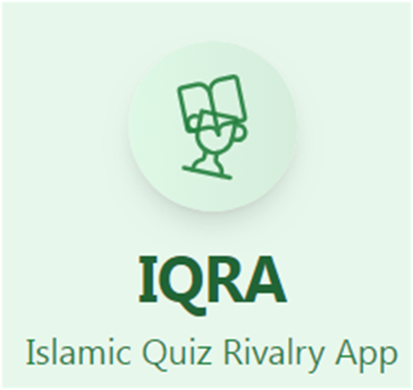
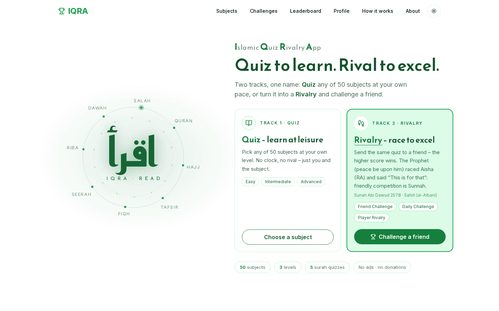

<div align="center">



# IQRA - Islamic Quiz Rivalry App

**Quiz to learn. Rival to excel.**

[Live site](https://iqrar.vercel.app) &middot; [How it works](https://iqrar.vercel.app/how) &middot; [About](https://iqrar.vercel.app/about)

[](https://iqrar.vercel.app) [](https://nextjs.org) [](https://react.dev) [](https://www.typescriptlang.org) [](https://tailwindcss.com) [](#license) [](https://vercel.com)

<br />


</div>

---

IQRA is the first freeware open-source Islamic knowledge quiz app. Increase your knowledge of Islam by learning or playing quiz challenges. Our mission is to help Muslims and Arabic language enthusiasts develop a deeper connection with Islam and the Glorious Quran through interactive learning, quizz challenges, and gaming tools.

### Two tracks

| Track 1 &middot; Quiz | Track 2 &middot; Rivalry |
| --- | --- |
| **Quiz** &ndash; learn at leisure | **Rivalry** &ndash; race to excel |
| Pick any of 50 subjects at your own level. No clock, no rival &ndash; just you and the subject. | Send the same quiz to a friend &ndash; the higher score wins. The Prophet (peace be upon him) raced Aisha (RA) and said &ldquo;This is for that&rdquo;: friendly competition is Sunnah. |

<details>
<summary>Dark theme</summary>



</details>

---

## Table of contents

- [Features](#features)
- [Getting Started](#getting-started)
- [Technology Stack](#technology-stack)
- [Contributing](#contributing)
- [License](#license)
- [Acknowledgments](#acknowledgments)
- [Contact](#contact)

---

## Features

- Quiz challenges across 25 major subjects in Islam
- Interactive lessons to test and reinforce learning
- Vocabulary matching games
- Progress tracking
- Infographic examples from the Quran for context
- Responsive design for desktop and mobile use
- Word lists for organized learning
- Root word explorer

---

## Getting Started

### Prerequisites

- Node.js 18.0 or higher
- npm or yarn

### Installation

1. Clone the repository
   ```bash
   git clone https://github.com/iciso/iqra.git
   cd iqra
   ```

2. Install dependencies
   ```bash
   npm install
   # or
   yarn install
   ```

3. Run the development server
   ```bash
   npm run dev
   # or
   yarn dev
   ```

4. Open [http://localhost:3000](http://localhost:3000) in your browser

---

## Technology Stack

- **Next.js** - React framework for server-rendered applications
- **TypeScript** - For type safety and better developer experience
- **Tailwind CSS** - For responsive and customizable styling
- **Vercel** - For deployment and hosting

| Layer | Technology | Version |
| --- | --- | --- |
| Framework | Next.js | 16.4.6 |
| UI library | React | 19.3.1 |
| Language | TypeScript | ^5 |
| Styling | Tailwind CSS | ^3.4.17 |
| Hosting | Vercel | &ndash; |

---

## Contributing

We welcome contributions from developers, Arabic linguists, Quran scholars, and anyone passionate about making Quranic knowledge more accessible. See [How to Contribute](./contribute.md) for details.

---

## License

This project is licensed under the MIT License - see the [LICENSE](LICENSE) file for details.

---

## Acknowledgments

- IQRA Codes Team - Rafique and Joy who taught Rafique during the COVID-19 years.
- All contributors who have helped make this project better

---

## Contact

- Rafique - WhatsApp: +91 7558845528
- Joy - Email: joy_ahmed_007@yahoo.com, joy@zettabyteincorp.com · Website: https://joy.zettabyteincorp.com · GitHub: https://github.com/joyahmed

---

وهي صدقة جارية لوجه الله تعالى

This is an ongoing charity for the sake of  Allah ﷻ, The Entirely Generous.
